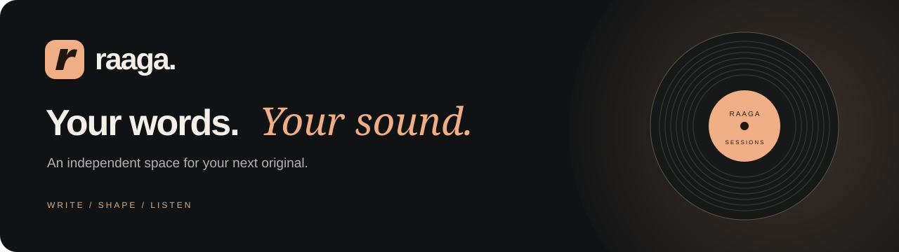
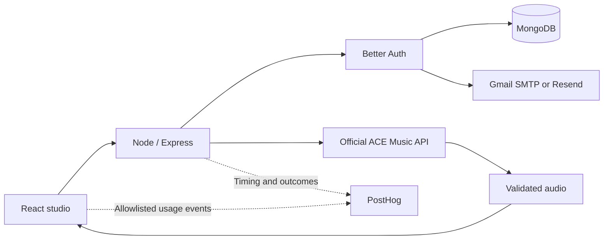

<p align="center">
  
</p>

<p align="center">
  A lyrics-first AI music studio. Bring your words, shape the sound, and take your song with you.
</p>

<p align="center">
  <a href="https://raaga-studio.vercel.app/">Open the studio</a> ·
  <a href="#quick-start">Run locally</a> ·
  <a href="docs/authentication.md">Authentication</a> ·
  <a href="CONTRIBUTING.md">Contribute</a>
</p>

<p align="center">
  
  
  
  
</p>

## A studio for the way you create

| Write | Shape | Listen |
| :--- | :--- | :--- |
| Paste your own lyrics, including verse and chorus labels. | Describe genre, mood, instruments and vocal delivery. | Preview your current song and download it before leaving. |

- **Your account, your key.** Connect a personal [ACE Music API key](https://acemusic.ai/playground/api-key) for the current session.
- **Vocals or instrumental.** Keep creative control over the words, or create music without vocals.
- **Flexible length.** Request a duration range from 10 seconds to 10 minutes; provider output length may vary.
- **Secure accounts.** Google sign-in and verified email/password accounts, with password reset and explicit account linking.
- **A focused workspace.** Responsive editor, sound presets, optional controls, cancellation and a listening room.
- **Privacy-conscious analytics.** Product events and generation timing through PostHog, without lyrics, audio or credentials.

## What gets saved?

**Accounts persist. Songs do not.** MongoDB stores accounts, password hashes, sessions and verification records. The form, personal music key and current audio stay in browser memory; they are not saved to MongoDB or browser storage.

Refreshing or leaving clears the current studio. A new generation replaces the previous result. **Download your song before leaving.** Files you download and copies retained by ACE Music are outside Raaga's cleanup. Configured PostHog usage events follow the project's analytics retention policy.

## Quick start

Use **Node.js 24.x** and npm. You will need MongoDB Atlas plus at least one configured sign-in method. A shared music key is optional because listeners can connect their own.

```bash
git clone https://github.com/ayush-gupta456/Raaga-ai-powered-music.git
cd Raaga-ai-powered-music
npm ci
```

Copy `.env.example` to `.env`, fill in your server settings, then run:

```bash
npm run build:node
npm run start:node
```

Open **http://127.0.0.1:3000**. Use that exact origin in local auth configuration. Private GitHub repositories require permission to clone.

### Environment essentials

| Variable | Purpose |
| :--- | :--- |
| `MONGODB_URI` | Account database connection string. |
| `BETTER_AUTH_SECRET` | Stable, cryptographically random secret of at least 32 characters. |
| `BETTER_AUTH_URL` | Exact app origin: local URL above, or your production HTTPS URL. |
| `GOOGLE_CLIENT_ID`, `GOOGLE_CLIENT_SECRET` | Google web OAuth credentials, if Google sign-in is enabled. |
| `GMAIL_APP_PASSWORD` | Gmail app password for verification/reset mail. Never use your Google password. |
| `GMAIL_USER` | Gmail sender; defaults to the project owner's configured sender. |
| `POSTHOG_PROJECT_TOKEN`, `POSTHOG_HOST` | Optional public ingestion token and matching US/EU region. |
| `ACESTEP_API_KEY` | Optional shared server key; a connected personal key overrides it per request. |
| `MUSIC_TIMEOUT_MS` | Use `280000` with the configured 300-second Vercel function budget. |

Gmail and Resend are alternative mail providers. See [.env.example](.env.example) for all options and [authentication setup](docs/authentication.md) for OAuth callbacks, Gmail, Resend and verification behavior. All credentials are server-only; do not prefix them with `VITE_` or `NEXT_PUBLIC_`.

## Architecture



| Location | Responsibility |
| :--- | :--- |
| `components/` | Authentication and music studio interfaces. |
| `client/` | In-memory audio lifecycle and explicit usage events. |
| `server/` | Verified sessions, mail delivery, security headers and Express routes. |
| `lib/` | Generation validation, provider requests, limits and audio checks. |
| `node-web/` | Primary Vite frontend entrypoint for Node/Vercel. |
| `tests/` | Auth, email, generation, analytics and security regression tests. |
| `app/`, `worker/` | Retained legacy Sites/Cloudflare target with platform-managed access. |

The Node/Vercel target is the primary deployment. The legacy Sites target has a separate authentication model; its sessions are not shared with Vercel.

## Development and checks

```bash
npm test
npm run typecheck
npm run lint
npm run build:vercel
```

| Command | Use |
| :--- | :--- |
| `npm run build:node` | Build the primary browser app. |
| `npm run start:node` | Serve the authenticated app locally. |
| `npm run build:vercel` | Build the browser app and prepare Vercel CDN assets. |
| `npm run dev` | Develop the retained Sites target. |
| `npm run build` | Verify the legacy Sites/Worker build. |

CI runs tests, types, lint, both builds and a dependency audit on Node 24 without production credentials. Automated provider tests use isolated fixtures; they do not spend music credits or send real email. Live OAuth consent, inbox delivery and a real personal-key generation require separate verification.

## Deploy to Vercel

1. Import this repository into Vercel using the Express framework preset.
2. Add Production environment variables from `.env.example`; register the exact production Google callback.
3. The checked-in `vercel.json` selects the build command and function configuration.
4. Deploy, then test sign-in → verification → generation → playback → download → sign-out.

Google callback: `<BETTER_AUTH_URL>/api/auth/callback/google`. Redeploy after changing environment variables. Keep production secrets and databases separate from previews.

## Practical limits

ACE Music controls credits, availability, output quality and final duration. The app bounds request/response sizes and wait time; a requested ten-minute song can still exceed Vercel's execution budget or the provider response limit. Stopping locally does not guarantee cancellation at the provider. There are no automatic generation retries.

Music rate/concurrency counters are per instance, not a global distributed quota. Authentication rate limits are MongoDB-backed. Gmail applies account sending limits; a dedicated transactional sender is preferable as traffic grows.

## Project resources

- [Authentication and email setup](docs/authentication.md)
- [Analytics and AI observability](docs/analytics.md)
- [Design, security and verification review](docs/redesign-review.md)
- [Contributing](CONTRIBUTING.md) · [Security reporting](SECURITY.md)
- [Historical implementation notes](docs/archive/)

## License

No project license has been selected. A public URL or access to the repository does not grant a redistribution license. Dependency licenses remain with their respective authors.
